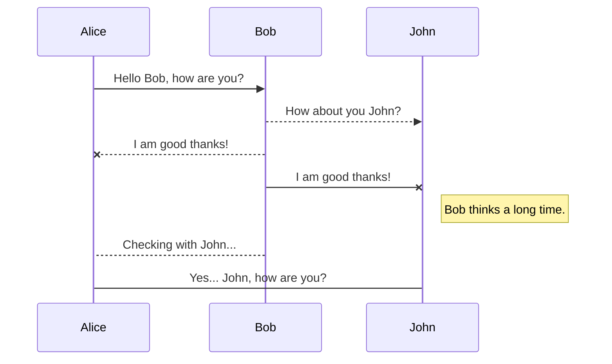
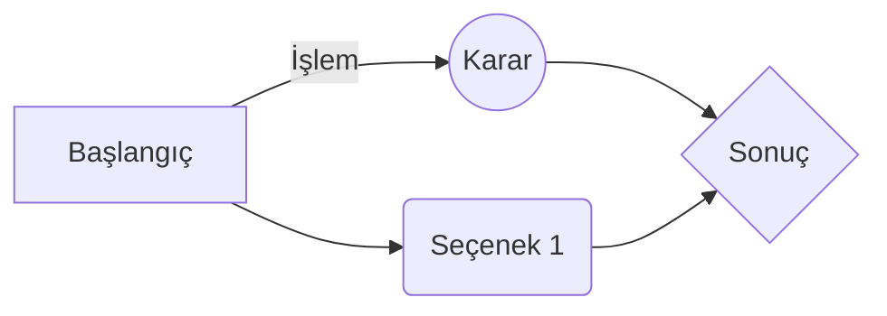

# Başlık Seviyesi 1 (H1)
## Başlık Seviyesi 2 (H2)
### Başlık Seviyesi 3 (H3)
#### Başlık Seviyesi 4 (H4)
##### Başlık Seviyesi 5 (H5)
###### Başlık Seviyesi 6 (H6)

---

## Metin Biçimlendirme ve Vurgular

*Bu metin italiktir* veya _bu metin italiktir_.  
**Bu metin koyudur** veya __bu metin koyudur__.  
***Bu metin hem koyu hem italiktir***.  
~~Bu metnin üzeri çizilidir.~~  
==Bu metin fosforlu/vurguludur.==  
H~2~O (Alt simge) ve X^2^ (Üst simge)

---

## Listeler

### Sırasız Liste
* Birinci öge
  * Alt öge 1
  * Alt öge 2
* İkinci öge
* Üçüncü öge

### Sıralı Liste
1. Birinci adım
2. İkinci adım
   1. Alt adım A
   2. Alt adım B
3. Üçüncü adım

### Görev Listesi (Task List)
- [x] Tamamlanmış görev
- [ ] Bekleyen görev 1
- [ ] Bekleyen görev 2

### Tanım Listesi (Definition List)
Markdown
: Metin tabanlı işaretleme dili.

---

## Bağlantılar ve Görseller

[StackEdit Sayfasına Git](https://stackedit.io)  
[Referans Tipi Bağlantı][1]

Görsel örneği:  


[1]: https://markdownlivepreview.com "Referans Bağlantı Başlığı"

---

## Alıntılar (Blockquotes)

> Bu tek seviyeli bir alıntı bloğudur.
> 
>> Bu iç içe geçmiş ikinci seviye alıntıdır.
>>> Üçüncü seviye alıntı.

---

## Kod Bloğu ve Sözdizimi Vurgulama

Satır içi kod kullanımı: `npm install stackedit`

Çok satırlı JavaScript kod bloğu:
```java
function selamla(isim) {
  console.log(`Merhaba, ${isim}!`);
}
selamla('Dünya');
```

Çok satırlı Python kod bloğu:
```python
def topla(a, b):
    return a + b

print(topla(5, 10))
```

---

## Tablolar

| Sütun 1 (Sola Hizalı) | Sütun 2 (Ortalı) | Sütun 3 (Sağa Hizalı) |
| :--- | :---: | ---: |
| Hücre 1 | Hücre 2 | 100 ₺ |
| Veri A | Veri B | 250 ₺ |
| Metin | Metin | 1.000 ₺ |

---

## Matematiksel İfadeler (KaTeX / MathJax)

Satır içi matematiksel ifade: $E = mc^2$

Blok matematiksel ifade:
$$
\Gamma(z) = \int_0^\infty t^{z-1}e^{-t}dt
$$

---

## UML Şemaları ve Akış Şemaları (Mermaid)

### Sequence Diagram


### Flowchart


---

## Yerleşik HTML Etiketleri

<details>
<summary>Detayları görmek için tıklayın (Collapsible/Accordion)</summary>
<br>
Gizli metin içeriği buradadır. Markdown editörleri HTML etiketlerini de destekler.
</details>

<br>

Kırmızı renkte <font color="red">metin yazımı</font> ve <u>altı çizili metin</u>.

--


yhhhjkjkjhkjhkjkhkjhkjhjkhjkhdsfsfsdf sdsf sdfs


# Başlık Seviyesi 1 (H1)
## Başlık Seviyesi 2 (H2)
### Başlık Seviyesi 3 (H3)
#### Başlık denemesi 4 (H4)
##### Başlık Seviyesi 5 (H5)
###### Başlık Seviyesi 6 (H6)

---

## Metin Biçimlendirme ve Vurgular

*Bu metin italiktir* veya _bu metin italiktir_.  
**Bu metin koyudur** veya __bu metin koyudur__.  
***Bu metin hem koyu hem italiktir***.  
~~Bu metnin üzeri çizilidir.~~  
==Bu metin fosforlu/vurguludur.==  
H~2~O (Alt simge) ve X^2^ (Üst simge)


### Sırasız Liste
* Birinci öge
  * Alt öge 1
  * Alt öge 2
* İkinci öge
* Üçüncü öge

### Sıralı Liste
1. Birinci adım
2. İkinci adım
   1. Alt adım A
   2. Alt adım B
3. Üçüncü adım


*Bu metin italiktir* veya _bu metin italiktir_.  
**Bu metin koyudur** veya __bu metin koyudur__.  
***Bu metin hem koyu hem italiktir***.  
~~Bu metnin üzeri çizilidir.~~  
==Bu metin fosforlu/vurguludur.==  
H~2~O (Alt simge) ve X^2^ (Üst simge)


*Bu metin italiktir* veya _bu metin italiktir_.  
**Bu metin koyudur** veya __bu metin koyudur__.  
***Bu metin hem koyu hem italiktir***.  
~~Bu metnin üzeri çizilidir.~~  
==Bu metin fosforlu/vurguludur.==  
H~2~O (Alt simge) ve X^2^ (Üst simge)

---