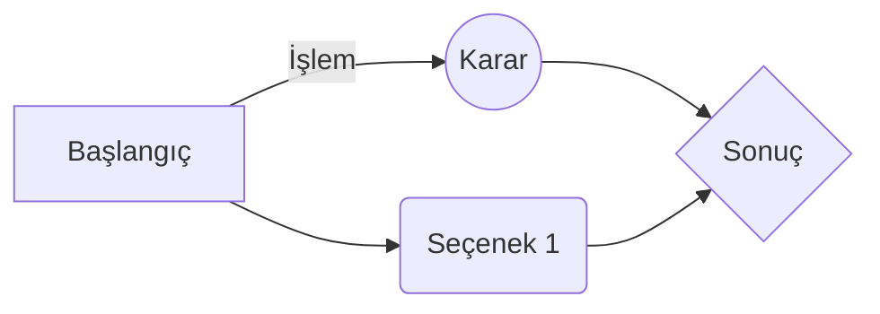

# Başlık Seviyesi 1 (H1)
## Başlık Seviyesi 2 (H2)
### Başlık Seviyesi 3 (H3)
#### Başlık Seviyesi 4 (H4)
##### Başlık Seviyesi 5 (H5)
###### Başlık Seviyesi 6 (H6)

---

## Metin Biçimlendirme ve Vurgular

*Bu metin italiktir* veya _bu metin italiktir_.  
**Bu metin koyudur** veya __bu metin koyudur__.  
***Bu metin hem koyu hem italiktir***.  
~~Bu metnin üzeri çizilidir.~~  
==Bu metin fosforlu/vurguludur.==  
H~2~O (Alt simge) ve X^2^ (Üst simge)

---

## Listeler

### Sırasız Liste
* Birinci öge
  * Alt öge 1
  * Alt öge 2
* İkinci öge
* Üçüncü öge

### Sıralı Liste
1. Birinci adım
2. İkinci adım
   1. Alt adım A
   2. Alt adım B
3. Üçüncü adım

- [x] Tamamlanmış görev
- [ ] Bekleyen görev 1
- [ ] Bekleyen görev 2

### Tanım Listesi (Definition List)
Markdown
: Metin tabanlı işaretleme dili.

---

## Bağlantılar ve Görseller

[StackEdit Sayfasına Git](https://stackedit.io)  
[Referans Tipi Bağlantı][1]

Görsel örneği:  

[1]: https://markdownlivepreview.com "Referans Bağlantı Başlığı"

---

### Flowchart

---

## Yerleşik HTML Etiketleri
yhhhjkjkjhkjhkjkhkjhkjhjkhjkhdsfsfsdf sdsf sdfs

