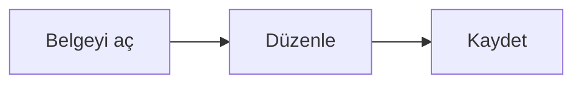

# Editör deneme belgesi

Bu belge **biçimlendirme**, *yazım* ve görünüm testleri için sabit test verisidir.

## Görevler

- [ ] İlk görev
- [x] İkinci görev

## Tablo

| Ad | Değer |
| --- | --- |
| Örnek | 3 |

## Matematik

$x^2$ ve $a+b$.

## Diyagram

Son paragraf.
